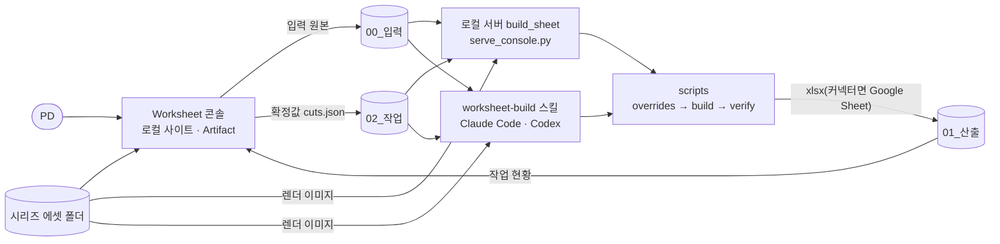

# worksheet-agent

토스트 애니메이션 스튜디오의 애니메이션 워크시트 에이전트입니다. PD가 시나리오(docx·pptx·txt·md)와 스토리보드(PDF)를 올리면, 컷 분할·썸네일·에셋·러닝타임을 거쳐 Description 열까지 채운 에피소드 Worksheet 초안을 Google Sheet로 만듭니다. 그 뒤의 공정 열(LO·AN·Render·Comp)은 작업자가 각자 채웁니다.

같은 플러그인을 Claude Code와 Codex에서 씁니다. 상태는 개발 초기(0.0.4)이며, 계획과 결정은 [`docs/PLAN.md`](docs/PLAN.md), 용어는 [`CONTEXT.md`](CONTEXT.md), 저장소 규칙은 [`AGENTS.md`](AGENTS.md)에 있습니다.

## 설치

처음 쓰는 PC는 아래 1~4를 순서대로 한 번만 하면 됩니다. 예시는 프로젝트 폴더를 `D:\ToastWorksheet`로 둡니다. 다른 드라이브나 이름을 써도 되며, 그때는 명령의 경로를 같이 바꿉니다.

### 준비물

| 항목 | 용도 | 확인 방법 |
|---|---|---|
| Windows 10·11 | 스토리보드 PDF는 글자 층이 없는 그림이라 Windows 내장 한국어 OCR(`ocr_win.ps1`)로 읽습니다 | 설정 → 시간 및 언어 → 언어에 한국어가 있는지 |
| Git | 저장소 내려받기와 갱신 | `git --version` |
| Python 3.11 이상 | 파싱·계산·조립 스크립트 | `python --version` |
| Claude Code 또는 Codex | 플러그인 실행 | `claude --version` 또는 `codex --version` |

### 1. 로컬 드라이브에 프로젝트 폴더 만들기

PowerShell을 열고 프로젝트 폴더를 만든 뒤, 그 안에 저장소를 내려받습니다. 저장소(`serashin-tech/worksheet-agent`)는 공개되어 있어서 GitHub 로그인 없이 받을 수 있습니다.

```powershell
New-Item -ItemType Directory -Force D:\ToastWorksheet
cd D:\ToastWorksheet
git clone https://github.com/serashin-tech/worksheet-agent.git
```

- Git을 쓰지 않는다면 브라우저에서 저장소를 열고 **Code → Download ZIP**으로 받은 뒤, 압축을 `D:\ToastWorksheet\worksheet-agent`에 풉니다. 이 경우 새 버전도 ZIP을 다시 받아 덮어씁니다.

이어서 스크립트가 쓰는 Python 패키지를 설치합니다.

```powershell
pip install openpyxl numpy pymupdf pillow python-docx python-pptx
```

다 끝나면 폴더가 이렇게 됩니다.

```
D:\ToastWorksheet\
  worksheet-agent\          내려받은 저장소(플러그인 원본)
    .claude-plugin\         Claude Code 마켓플레이스
    .agents\plugins\        Codex 마켓플레이스
    plugin\                 스킬·스크립트·콘솔
```

Claude Code나 Codex는 늘 `D:\ToastWorksheet`에서 실행합니다. 작업 결과(시트, `cuts.json`)는 이 폴더가 아니라 Google Drive 작업 폴더에 저장됩니다.

### 2. Google 연결: 커넥터와 Google Drive 데스크톱 앱

플러그인은 Google Drive를 두 경로로 씁니다.

| 경로 | 쓰는 곳 | 필요 여부 |
|---|---|---|
| **Google Drive 데스크톱 앱** | 로컬 콘솔이 작업 폴더·에셋 폴더를 PC 경로(`G:\…`)로 읽고 씁니다. 스토리보드 PDF는 대개 10MB를 넘어 커넥터로 주고받지 못하기 때문입니다([ADR 0006](docs/adr/0006-original-pdf-via-sync-folder.md)) | Claude Code·Codex 모두 **필수** |
| **Google Drive·Google Sheets 커넥터(MCP)** | 콘솔 밖에서 "시트 만들어 줘"라고 할 때 Claude Code가 Drive 폴더를 찾고 완성한 시트를 Google Sheet로 올립니다. 로컬 콘솔은 4단계에서 데스크톱 앱 폴더에 xlsx를 바로 만들므로 커넥터 없이도 동작합니다 | Claude Code에서 권장. Codex는 쓰지 않습니다(로컬 모드) |

#### 2-1. Google Drive 데스크톱 앱 설치

1. [Google Drive 데스크톱 다운로드 페이지](https://www.google.com/drive/download/)에서 설치 파일을 받아 설치합니다.
2. 실행하면 뜨는 로그인 창에서 **회사 Google 계정**으로 로그인합니다. 작업 폴더와 에셋 폴더에 권한이 있는 계정이어야 합니다.
3. 작업 표시줄의 Drive 아이콘 → 톱니바퀴 → **환경설정 → Google Drive**에서 **파일 스트리밍**을 고릅니다. 드라이브 문자는 기본값 `G:`를 그대로 둡니다.
4. 파일 탐색기에서 `G:\내 드라이브`와 `G:\공유 드라이브`가 보이는지 확인합니다.
5. 작업 폴더가 **공유 문서함**에만 있으면 G:에 나타나지 않습니다. 웹 Drive에서 그 폴더를 오른쪽 클릭 → **정리 → 바로가기 추가**로 내 드라이브에 바로가기를 만듭니다.

#### 2-2. Claude Code에 Google 커넥터 연결

Claude Code의 Google 커넥터는 claude.ai 계정 설정에서 연결하고, 같은 계정으로 로그인한 Claude Code가 그대로 가져다 씁니다.

1. 브라우저에서 [claude.ai](https://claude.ai)에 로그인하고 **설정 → 커넥터**로 갑니다.
2. **Google Drive**를 찾아 **연결**을 누르고, 회사 Google 계정으로 권한을 허용합니다.
3. **Google Sheets**도 같은 방법으로 연결합니다.
4. Claude Code가 같은 claude.ai 계정으로 로그인되어 있는지 확인합니다(`claude` 실행 후 `/status`). 다른 계정이면 `/login`으로 다시 로그인합니다.
5. Claude Code에서 `/mcp`를 입력해 Google Drive와 Google Sheets가 연결됨으로 나오는지 봅니다.

Codex에는 이 단계가 없습니다. Codex에서는 `worksheet-build`가 로컬 모드로 동작해 `01_산출`에 xlsx를 만들고, 데스크톱 앱이 그 파일을 Drive에 올립니다.

### 3. 플러그인 설치

1에서 내려받은 폴더를 마켓플레이스로 등록하고 플러그인을 설치합니다.

#### Claude Code

```powershell
claude plugin marketplace add D:\ToastWorksheet\worksheet-agent
claude plugin install worksheet-agent@worksheet-agent
```

- Claude Code 안에서는 `/plugin marketplace add D:\ToastWorksheet\worksheet-agent`와 `/plugin install worksheet-agent@worksheet-agent`로도 설치할 수 있습니다.
- 설치 뒤 Claude Code를 다시 열고 `/plugin`에서 `worksheet-agent`가 켜져 있는지 확인합니다.
- 새 버전은 저장소 폴더에서 `git pull`을 실행한 뒤 `claude plugin marketplace update worksheet-agent`와 `claude plugin update worksheet-agent@worksheet-agent`로 받습니다.

#### Codex

```powershell
codex plugin marketplace add D:\ToastWorksheet\worksheet-agent
codex plugin add worksheet-agent@worksheet-agent
```

- `codex plugin list`에서 `worksheet-agent`가 설치됨으로 나오는지 확인하고 새 세션을 엽니다.
- 새 버전은 저장소 폴더에서 `git pull`을 실행한 뒤 `codex plugin add worksheet-agent@worksheet-agent`를 다시 실행하고 새 세션을 엽니다. `codex plugin list`의 버전이 `plugin/.codex-plugin/plugin.json`의 `version`과 같으면 새 버전입니다.
- Codex의 샌드박스가 `workspace-write`이면 Python 실행이 막힐 수 있습니다. 이때는 스크립트 실행을 승인하거나 샌드박스를 넓힙니다.

> 저장소를 내려받지 않고 GitHub에서 바로 설치할 수도 있습니다. 마켓플레이스 경로 자리에 `serashin-tech/worksheet-agent`를 넣으면 됩니다(`claude plugin marketplace add serashin-tech/worksheet-agent`, `codex plugin marketplace add serashin-tech/worksheet-agent`). 새 버전은 Claude Code에서 `claude plugin marketplace update worksheet-agent`, Codex에서 `codex plugin marketplace upgrade worksheet-agent`로 받은 뒤 플러그인을 다시 설치합니다. 다만 이 방식에서는 아래 4의 "직접 띄우기"에 쓸 로컬 스크립트 경로가 없습니다.

### 4. Worksheet 콘솔 호출

PD가 쓰는 화면은 **Worksheet 콘솔**입니다. 원본은 `plugin/console/console.html`이며, Claude Code와 Codex에서는 이 콘솔을 PC의 로컬 사이트로 엽니다.

1. PowerShell에서 프로젝트 폴더로 가서 Claude Code나 Codex를 실행합니다.

   ```powershell
   cd D:\ToastWorksheet
   claude
   ```

   Codex라면 마지막 줄을 `codex`로 바꿉니다.
2. 대화창에 이렇게 입력합니다.

   ```
   워크시트 콘솔 띄워 줘
   ```

   `worksheet-console` 스킬이 커넥터 연결을 확인한 뒤 서버를 띄웁니다. 스킬 이름으로 직접 부르려면 Claude Code에서는 `/worksheet-agent:worksheet-console`, Codex에서는 `$`를 입력해 나오는 스킬 목록에서 `worksheet-agent:worksheet-console`을 고릅니다.
3. 브라우저가 `http://127.0.0.1:8765/`로 열립니다. 열리지 않으면 이 주소를 직접 입력합니다. 서버는 이 PC에서만 열립니다.
4. 콘솔의 **Google 연결 설정**에서 다음을 확인합니다.
   - 1단계: Google Drive·Google Sheets 커넥터와 Google Drive 데스크톱 앱이 "연결됨"인지 봅니다. 커넥터가 "연결 안 됨"이면 2-2를 마친 뒤 "워크시트 콘솔 다시 띄워 줘"라고 말합니다. Codex에서는 커넥터가 "확인 안 함"으로 나오며 그대로 써도 됩니다.
   - 2단계: 작업 폴더의 Drive 주소(`https://drive.google.com/drive/folders/…`)를 붙여 넣고 **폴더 연결**을 누릅니다. 서버가 데스크톱 앱에서 그 폴더의 PC 경로(`G:\내 드라이브\…`, `G:\공유 드라이브\…`)를 찾고, 연결한 폴더 안에서만 읽고 씁니다.
5. 다 쓰면 "콘솔 닫아 줘"라고 말해 서버를 멈춥니다.

#### 직접 띄우기

스킬을 거치지 않고 PowerShell에서 바로 띄울 수도 있습니다.

```powershell
python -I D:\ToastWorksheet\worksheet-agent\plugin\scripts\serve_console.py --connectors "Google Drive,Google Sheets"
```

- `--connectors`에는 연결된 커넥터 이름만 넣습니다. Codex처럼 커넥터가 없으면 이 옵션을 뺍니다.
- 포트 8765가 이미 쓰이고 있으면 `--port 8766`을 붙입니다.
- 데스크톱 앱의 메타데이터 DB는 Google이 공개한 형식이 아니라서, 앱이 바뀌면 폴더를 찾지 못할 수 있습니다. 이때는 `--root "<PC 폴더>"`로 폴더를 직접 넘깁니다.
- 시연 데이터 없이 시작합니다. PD가 시나리오를 올리면 컷 목록을, 스토리보드 PDF를 올리면 썸네일·칸·대사(OCR)를 서버가 만듭니다(스토리보드는 1~2분). 미리 만든 시연 데이터(`cuts.json·thumbs.json·panels.json·work.json`)로 보여 줄 때만 `--data "<폴더>"`를 붙입니다.

#### claude.ai Artifact 콘솔

같은 콘솔을 claude.ai에 Artifact로 게시해 브라우저에서 바로 쓸 수도 있습니다. 처음 열 때 Google Drive·Google Sheets 사용을 승인해야 폴더와 시트를 읽고 저장할 수 있습니다. 다만 커넥터는 파일 하나를 10MB까지만 주고받으므로, 큰 스토리보드는 로컬 콘솔에서 다룹니다.

## 사용법

### 1. 작업 폴더 연결

콘솔 첫 화면에서 회사 작업 폴더(Google Drive 링크)를 연결합니다. 콘솔은 그 아래에 `애니메이션명/EP##/` 폴더와 하위 폴더 세 개를 만들어 씁니다. 폴더가 이미 있으면 그대로 씁니다.

| 폴더 | 내용 |
|---|---|
| `00_입력` | 올린 시나리오와 스토리보드 원본 |
| `01_산출` | 완성한 Worksheet. 로컬 콘솔은 xlsx를 넣고, 커넥터로 올리면 Google Sheet가 됩니다 |
| `02_작업` | 콘솔에서 확정한 값(`cuts.json`) |

### 2. 콘솔 5단계

| 단계 | PD가 하는 일 | 결과 |
|---|---|---|
| 1. 시나리오 | 시나리오 파일을 올리고 애니메이션명, 에피소드 번호, 에피소드 제목, 방영 길이(분), 목표 컷 수를 확인 | 컷 목록 |
| 2. 스토리보드 | 스토리보드 PDF를 올리고 컷 번호와 SHOT을 대조 | 컷마다 SHOT과 THUMBNAIL |
| 3. 에셋 | 시리즈 에셋 폴더를 연결하고 SHOT마다 BG·CH·PR을 고름. 에셋마다 리깅을 고르고 이미지를 바꿀 수 있으며, 폴더에 없는 에셋은 손으로 더함 | 확정한 에셋 목록 |
| 4. 워크시트 | 분할, Frame, Start Frame, 러닝타임 FPS, 드롭다운 목록을 확인하고 "확정하고 시트 만들기"를 누름 | `02_작업/cuts.json`. 로컬 콘솔은 `01_산출`의 xlsx와 검증 결과까지 |
| 5. 작업 현황 | 4단계에서 만든 시트를 읽거나, 다른 시트의 Google Sheets 링크를 붙여 넣어 업무별·사람별 진행을 봄 | 현황 |

에셋 폴더에는 `BG / CH / PR` 하위 폴더를 두고, 파일 이름을 에셋 이름으로 씁니다. 하늘 배경은 `Matte`, 이미지 배경은 `2D` 폴더에 두면 BG 열에서 함께 고를 수 있습니다. 워크시트의 Asset 탭과 BG·CH·PR 열은 3단계에서 확정한 값으로 채웁니다. 로컬 콘솔에서 "이미지 바꾸기"를 누르면 에셋 폴더의 원본 파일을 덮어씁니다(Drive 버전 기록에 이전 파일이 남습니다).

### 3. 시트 만들기

**로컬 콘솔**(Claude Code·Codex)에서는 4단계 "확정하고 시트 만들기"가 시트까지 만듭니다. 서버가 `02_작업/cuts.json`과 `00_입력`의 가장 최근 시나리오로 조립·검증해 `01_산출`에 xlsx를 넣고, 결과 화면에 파일 이름과 검증 결과를 보여 줍니다. 데스크톱 앱이 그 파일을 Drive에 올리면 "Google Sheets에서 열기" 링크가 나옵니다(보통 1~2분).

**Artifact 콘솔**은 xlsx를 만들지 못합니다. 4단계에서 `cuts.json`을 남긴 뒤, Claude Code나 Codex에서 이렇게 요청합니다. 로컬 콘솔을 쓰다가 콘솔 밖에서 다시 만들 때도 같습니다.

```
작업 폴더 <링크>의 뽀로로 EP12 시트 만들어 줘
```

`worksheet-build` 스킬이 다음 순서로 진행합니다.

1. 에피소드 폴더에서 최신 `cuts.json`, 시나리오, 스토리보드, 에셋 렌더 이미지를 내려받습니다.
2. `console_overrides.py`로 콘솔의 확정값을 조립용 값으로 바꿉니다.
3. `build_worksheet.py`로 xlsx를 조립하고 `verify_worksheet.py`로 검증합니다. FAIL이 있으면 올리기 전에 PD에게 항목을 보여 줍니다.
4. 커넥터가 있으면 `01_산출`에 Google Sheet로 올리고 링크를 돌려줍니다. 커넥터가 없으면(로컬 모드) `01_산출`에 xlsx를 넣고 경로를 돌려줍니다. 어느 쪽이든 기존 시트는 덮어쓰지 않고, 이름에 날짜(같은 이름이 있으면 시각까지)를 붙여 새로 만듭니다.

다른 PC나 나중에 작업 현황을 보려면 콘솔 5단계의 "볼 워크시트"에 그 시트의 Google Sheets 링크를 붙여 넣고 "링크로 읽기"를 누릅니다. 로컬 콘솔은 콘솔이 만든 xlsx의 링크만 읽습니다. Drive에서 "Google Sheets로 저장"으로 만든 사본은 읽지 못합니다.

## Architecture



### 층별 역할

| 층 | 위치 | 맡는 일 | 맡지 않는 일 |
|---|---|---|---|
| 콘솔 | `plugin/console/console.html` | PD의 판단(컷 대조, 분할, 에셋 선택, Frame 확인)을 받는 화면. 입력 원본과 `cuts.json`을 Drive에 저장 | 숫자 계산과 xlsx 조립 |
| 로컬 서버 | `plugin/scripts/serve_console.py` | 콘솔의 Drive 호출을 데스크톱 앱 폴더에서 처리, 시나리오·스토리보드로 콘솔 데이터 생성, 4단계 시트 조립 실행, 작업 현황용 xlsx 읽기 | 연결한 폴더 밖 읽기·쓰기 |
| 스킬 | `plugin/skills/worksheet-console/`, `plugin/skills/worksheet-build/` | 콘솔 서버 띄우기, 콘솔 밖 시트 만들기(폴더 찾기, 내려받기, 스크립트 실행 순서, FAIL 보고, 업로드) | 숫자 계산 |
| 스크립트 | `plugin/scripts/` | 파싱, 계산, 조립, 검증. 입력이 같으면 결과도 늘 같음 | 사람의 판단 |

숫자는 모두 스크립트가 계산하고, AI는 숫자를 쓰지 않습니다([ADR 0003](docs/adr/0003-deterministic-calc-by-scripts.md)). 시트에는 Frame을 `End Frame - Start Frame + 1`, Sec를 `ROUND(Frame/FPS, 1)` 수식으로 넣습니다. FPS는 코드에 고정하지 않고, 콘솔 4단계의 "러닝타임 FPS" 칸에 PD가 정한 값(기본 24, 스토리보드 머리글의 값)을 시트 수식과 검증이 그대로 씁니다([ADR 0005](docs/adr/0005-fps-from-storyboard.md)).

### 데이터 흐름

1. **시나리오 → 컷**: `parse_docx.py`가 번호 매기기 목록에서 컷 번호를 읽고 지문과 대사를 나눕니다. `scenario_meta.py`는 머리말의 목표 컷 수와 에피소드 제목을 읽습니다.
2. **스토리보드 → SHOT·THUMBNAIL**: `label_sheets.py`가 컷이 시작하는 칸을 찾고, `storyboard_panels.py`가 칸(SHOT)을 나누고, `storyboard_text.py`가 OCR로 DIALOGUE·NOTE를 읽고, `thumbnails.py`가 컷의 첫 칸을 썸네일로 자릅니다. 컷 번호는 OCR로 읽지 않습니다. 칸에는 순번(S001…)만 붙고, PD가 콘솔 2단계에서 시나리오 컷과 짝짓습니다. (`panel_split.py`는 초기 PoC이며 지금 흐름에서는 쓰지 않습니다.)
3. **에셋**: 콘솔이 에셋 폴더의 파일 이름으로 목록을 만듭니다(`folder_assets.py`와 같은 규칙). 이미지 매칭은 쓰지 않습니다([ADR 0004](docs/adr/0004-no-image-asset-matching.md)). PD가 콘솔 3단계에서 SHOT마다 고르고 확정합니다.
4. **조립**: `build_worksheet.py`가 탭 세 개를 만듭니다.
   - 에피소드 탭: CUT부터 Description까지, 공정 열 드롭다운
   - Asset 탭: 분류 BG·CH·PR·Matte·2D, 리깅 드롭다운, 렌더 이미지
   - 요약 탭: 총 러닝타임과 컷 수 비교, 작업자별 집계

   PD가 확인하지 않은 Frame은 노란색으로 표시합니다. 값은 콘솔이 넘긴 Frame(콘솔이 `frame_model.json`으로 컷마다 추정해 분할 행에 나눈 값)을 그대로 쓰고, 콘솔 값이 없는 행만 시트에서 추정합니다.
5. **검증**: `verify_worksheet.py`가 시트만으로 15개 항목을 확인합니다. 컷 번호 연속, 행 ID 중복, Frame·Sec 수식, 드롭다운, 썸네일, BG·CH·PR 코드가 Asset 탭에 있는지 등입니다. 조립 요약 파일(`out.summary.json`)을 함께 넘기면 노란색 Frame 행 수, 행 수, Frame 합계(콘솔 값과 같은지), FPS, 목표 컷 수, 총 러닝타임과 방영 길이의 차이까지 최대 21개를 확인합니다. 로컬 콘솔의 4단계와 `worksheet-build`는 요약 파일을 함께 넘깁니다.

### 저장소 구조

```
.claude-plugin/marketplace.json   Claude Code 마켓플레이스
.agents/plugins/marketplace.json  Codex 마켓플레이스
plugin/
  .claude-plugin/plugin.json      Claude Code 플러그인 매니페스트
  .codex-plugin/plugin.json       Codex 플러그인 매니페스트
  skills/worksheet-build/         시트 만들기와 01_산출 업로드 절차(커넥터가 없으면 로컬 모드)
  skills/worksheet-console/       콘솔을 로컬 사이트로 띄우는 절차(serve_console.py)
  scripts/                        파싱·계산·조립·검증 스크립트
  console/                        콘솔 원본(console.html), 글꼴, 로고
  assets/                         토스트 로고
docs/
  PLAN.md                         개발 계획, 결정, 개발 단계
  adr/                            설계 결정 기록
CONTEXT.md                        용어 정의
AGENTS.md                         에이전트 작업 지침(CLAUDE.md가 가져옴)
```

고객 원본(시나리오, 스토리보드, 정답 시트)과 그것으로 만든 시연 데이터(`plugin/console/*.json`)는 저장소에 두지 않습니다.

## 알려진 한계

- 커넥터로 주고받을 때는 요청 한도(10MB, base64 포함) 때문에 7MB가 넘는 파일을 올리거나 내려받지 못합니다. 로컬 콘솔은 데스크톱 앱 폴더를 직접 쓰므로 이 한도가 없습니다. EP12 시트는 약 4.8MB입니다.
- 콘솔에서 고친 Same Camera와 Cam Move는 아직 시트에 넘기지 않습니다. 시트를 조립할 때 시나리오에서 다시 뽑습니다.
- 스토리보드 칸의 컷 번호는 콘솔 2단계에서 PD가 짝짓습니다. `thumbnails.py`의 `ep12_label`은 EP12 시험용 규칙이라, 콘솔을 거치지 않은 옛 `cuts.json`(칸 정보 `sbp`가 없는 것)으로 다른 에피소드 시트를 만들 때는 쓰지 않습니다.- 총 러닝타임과 방영 길이의 허용 오차(0.5분)는 토스트 확인 전 가정입니다.
