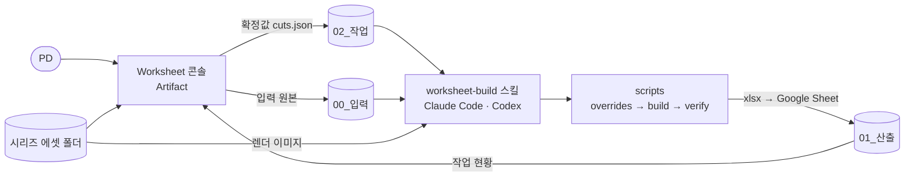

# worksheet-agent

토스트 애니메이션 스튜디오의 애니메이션 워크시트 에이전트입니다. PD가 시나리오(docx·pptx·txt·md)와 스토리보드(PDF)를 올리면, 컷 분할·썸네일·에셋·러닝타임을 거쳐 Description 열까지 채운 에피소드 Worksheet 초안을 Google Sheet로 만듭니다. 그 뒤의 공정 열(LO·AN·Render·Comp)은 작업자가 각자 채웁니다.

같은 플러그인을 Claude Code와 Codex에서 씁니다. 상태는 개발 초기(0.0.1)이며, 계획과 결정은 [`docs/PLAN.md`](docs/PLAN.md), 용어는 [`CONTEXT.md`](CONTEXT.md), 저장소 규칙은 [`AGENTS.md`](AGENTS.md)에 있습니다.

## 설치

저장소가 비공개(`serashin-tech/worksheet-agent`)라서 설치하는 PC의 GitHub 계정에 읽기 권한이 있어야 합니다. 먼저 `gh auth login`으로 로그인합니다.

### 공통 준비

1. **Python 3.11 이상**과 스크립트가 쓰는 패키지를 설치합니다.

   ```
   pip install openpyxl numpy pymupdf pillow python-docx python-pptx
   ```

2. **Google Drive·Google Sheets 커넥터**를 연결합니다. 플러그인은 작업 폴더를 찾고, 입력 파일을 내려받고, 완성한 시트를 올릴 때 이 커넥터를 씁니다.
3. **Windows**에서 씁니다. 스토리보드 PDF는 글자 층이 없는 그림이라 Windows 내장 한국어 OCR(`ocr_win.ps1`)로 읽습니다.
4. 스토리보드 PDF가 7MB를 넘으면 커넥터로 받지 못합니다. 이때는 PC의 Google Drive 동기화 폴더에서 원본을 읽으므로 Google Drive for desktop이 설치되어 있어야 합니다([ADR 0006](docs/adr/0006-original-pdf-via-sync-folder.md)).

### Claude Code

```
claude plugin marketplace add serashin-tech/worksheet-agent
claude plugin install worksheet-agent@worksheet-agent
```

Claude Code 안에서는 `/plugin marketplace add serashin-tech/worksheet-agent`와 `/plugin install worksheet-agent@worksheet-agent`로도 설치할 수 있습니다. 새 버전은 `claude plugin marketplace update worksheet-agent`로 받습니다.

### Codex

```
codex plugin marketplace add serashin-tech/worksheet-agent
codex plugin add worksheet-agent@worksheet-agent
```

Codex는 시작할 때 Git 마켓플레이스를 새로 읽습니다. 바로 갱신하려면 `codex plugin marketplace upgrade worksheet-agent`를 실행하고 새 세션을 엽니다.

### 콘솔

PD가 쓰는 화면은 claude.ai에 Artifact로 게시한 **Worksheet 콘솔**입니다. 원본은 `plugin/console/console.html`입니다. 처음 열 때 Google Drive·Google Sheets 사용을 승인해야 폴더와 시트를 읽고 저장할 수 있습니다.

Codex처럼 Artifact가 없거나 Google Drive 커넥터가 꺼진 곳에서는 같은 콘솔을 로컬 사이트로 엽니다. "워크시트 콘솔 띄워 줘"라고 하면 `worksheet-console` 스킬이 아래 명령으로 서버를 띄웁니다.

```
python -I plugin/scripts/serve_console.py --root "<작업 폴더>" --root "<시리즈 에셋 폴더>"
```

- 주소는 `http://127.0.0.1:8765/`입니다. 서버는 이 PC에서만 열리고, `--root`로 넘긴 폴더 밖은 읽지도 쓰지도 않습니다.
- 콘솔의 Drive 링크 칸에는 PC 폴더 경로를 붙여 넣습니다. 작업 폴더를 Google Drive 동기화 폴더(`G:\내 드라이브\…`) 안에 두면 저장한 파일이 Drive에도 올라갑니다.
- 시연 데이터 없이 시작합니다. PD가 시나리오를 올리면 컷 목록을, 스토리보드 PDF를 올리면 썸네일·칸·대사(OCR, Windows)를 서버가 만들어 화면에 채웁니다. 미리 만든 시연 데이터(`cuts.json·thumbs.json·panels.json·work.json`)로 보여 줄 때만 `--data "<폴더>"`를 붙입니다.
- Codex의 샌드박스가 `workspace-write`이면 Python 실행이 막힐 수 있습니다. 이때는 스크립트 실행을 승인하거나 샌드박스를 넓힙니다.

## 사용법

### 1. 작업 폴더 연결

콘솔 첫 화면에서 회사 작업 폴더(Google Drive 링크)를 연결합니다. 콘솔은 그 아래에 `애니메이션명/EP##/` 폴더와 하위 폴더 세 개를 만들어 씁니다. 폴더가 이미 있으면 그대로 씁니다.

| 폴더 | 내용 |
|---|---|
| `00_입력` | 올린 시나리오와 스토리보드 원본 |
| `01_산출` | 완성한 Worksheet(Google Sheet) |
| `02_작업` | 콘솔에서 확정한 값(`cuts.json`) |

### 2. 콘솔 5단계

| 단계 | PD가 하는 일 | 결과 |
|---|---|---|
| 1. 시나리오 | 시나리오 파일을 올리고 제목, 에피소드 번호, 방영 길이, 목표 컷 수를 확인 | 컷 목록 |
| 2. 스토리보드 | 스토리보드 PDF를 올리고 컷 번호와 SHOT을 대조 | 컷마다 SHOT과 THUMBNAIL |
| 3. 에셋 | 시리즈 에셋 폴더를 연결하고 SHOT마다 BG·CH·PR을 고름. 에셋마다 리깅, 디자인 필요, 비고를 적고, 폴더에 없는 에셋은 손으로 더함 | 확정한 에셋 목록 |
| 4. 워크시트 | 분할, Frame, Start Frame, 드롭다운 목록을 확인하고 "확정하고 시트 만들기"를 누름 | `02_작업/cuts.json` |
| 5. 작업 현황 | 작업 폴더의 시트를 골라 사람별·공정별 진행을 봄 | 현황 |

에셋 폴더에는 `BG / CH / PR` 하위 폴더를 두고, 파일 이름을 에셋 이름으로 씁니다. 하늘 배경은 `Matte`, 이미지 배경은 `2D` 폴더에 두면 BG 열에서 함께 고를 수 있습니다. 워크시트의 Asset 탭과 BG·CH·PR 열은 3단계에서 확정한 값으로 채웁니다.

### 3. 시트 만들기

콘솔은 xlsx를 직접 만들지 못합니다. 4단계에서 `cuts.json`을 남긴 뒤, Claude Code나 Codex에서 이렇게 요청합니다.

```
작업 폴더 <링크>의 뽀로로 EP12 시트 만들어 줘
```

`worksheet-build` 스킬이 다음 순서로 진행합니다.

1. 에피소드 폴더에서 최신 `cuts.json`, 시나리오, 스토리보드, 에셋 렌더 이미지를 내려받습니다.
2. `console_overrides.py`로 콘솔의 확정값을 조립용 값으로 바꿉니다.
3. `build_worksheet.py`로 xlsx를 조립하고 `verify_worksheet.py`로 검증합니다. FAIL이 있으면 올리기 전에 PD에게 항목을 보여 줍니다.
4. `01_산출`에 Google Sheet로 올리고 링크를 돌려줍니다. 기존 시트는 덮어쓰지 않고, 이름에 날짜를 붙여 새로 만듭니다.

시트를 올린 뒤 콘솔 5단계에서 "작업 폴더에서 찾기"를 누르면 새 시트가 목록에 나옵니다.

## Architecture



### 층별 역할

| 층 | 위치 | 맡는 일 | 맡지 않는 일 |
|---|---|---|---|
| 콘솔 | `plugin/console/console.html` | PD의 판단(컷 대조, 분할, 에셋 선택, Frame 확인)을 받는 화면. 입력 원본과 `cuts.json`을 Drive에 저장 | xlsx 생성(Artifact에서는 만들 수 없음) |
| 스킬 | `plugin/skills/worksheet-build/` | 폴더 찾기, 내려받기, 스크립트 실행 순서, FAIL 보고, 업로드 | 숫자 계산 |
| 스크립트 | `plugin/scripts/` | 파싱, 계산, 조립, 검증. 입력이 같으면 결과도 늘 같음 | 사람의 판단 |

숫자는 모두 스크립트가 계산하고, AI는 숫자를 쓰지 않습니다([ADR 0003](docs/adr/0003-deterministic-calc-by-scripts.md)). 시트에는 Frame을 `End Frame - Start Frame + 1`, Sec를 `ROUND(Frame/FPS, 1)` 수식으로 넣습니다. FPS는 스토리보드 머리글에 적힌 값을 씁니다([ADR 0005](docs/adr/0005-fps-from-storyboard.md)).

### 데이터 흐름

1. **시나리오 → 컷**: `parse_docx.py`가 번호 매기기 목록에서 컷 번호를 읽고 지문과 대사를 나눕니다. `scenario_meta.py`는 머리말의 목표 컷 수와 에피소드 제목을 읽습니다.
2. **스토리보드 → SHOT·THUMBNAIL**: `panel_split.py`와 `storyboard_panels.py`가 칸을 나누고, `storyboard_text.py`가 OCR로 컷 번호·대사·노트를 읽고, `thumbnails.py`가 컷의 첫 칸을 썸네일로 자릅니다.
3. **에셋**: `folder_assets.py`가 에셋 폴더의 파일 이름으로 목록을 만듭니다. 이미지 매칭은 쓰지 않습니다([ADR 0004](docs/adr/0004-no-image-asset-matching.md)). PD가 콘솔 3단계에서 SHOT마다 고르고 확정합니다.
4. **조립**: `build_worksheet.py`가 탭 세 개를 만듭니다.
   - 에피소드 탭: CUT부터 Description까지, 공정 열 드롭다운
   - Asset 탭: 분류 BG·CH·PR·Matte·2D, 리깅 드롭다운, 렌더 이미지
   - 요약 탭: 총 러닝타임과 컷 수 비교, 작업자별 집계

   PD가 확인하지 않은 Frame에는 `frame_model.json`의 추정값을 넣고 노란색으로 표시합니다.
5. **검증**: `verify_worksheet.py`가 19개 항목을 확인합니다. 컷 번호 연속, 행 ID 중복, Frame·Sec 수식, 드롭다운, 썸네일, BG·CH·PR 코드가 Asset 탭에 있는지, 총 러닝타임과 방영 길이의 차이 등입니다.

### 저장소 구조

```
.claude-plugin/marketplace.json   Claude Code 마켓플레이스
.agents/plugins/marketplace.json  Codex 마켓플레이스
plugin/
  .claude-plugin/plugin.json      Claude Code 플러그인 매니페스트
  .codex-plugin/plugin.json       Codex 플러그인 매니페스트
  skills/worksheet-build/         시트 만들기와 01_산출 업로드 절차(커넥터가 없으면 로컬 모드)
  skills/worksheet-console/       콘솔을 로컬 사이트로 띄우는 절차(serve_console.py)
  scripts/                        파싱·계산·조립·검증 스크립트
  console/                        콘솔 원본(console.html)과 글꼴
  assets/                         토스트 로고
docs/
  PLAN.md                         개발 계획, 결정, 개발 단계
  adr/                            설계 결정 기록
CONTEXT.md                        용어 정의
AGENTS.md                         에이전트 작업 지침(CLAUDE.md가 가져옴)
```

고객 원본(시나리오, 스토리보드, 정답 시트)과 그것으로 만든 시연 데이터(`plugin/console/*.json`)는 저장소에 두지 않습니다.

## 알려진 한계

- 커넥터 요청 한도 때문에 7MB가 넘는 파일은 Drive에 직접 올리거나 내려받지 못합니다. EP12 시트는 약 4.5MB입니다.
- 콘솔에서 고친 Same Camera와 Cam Move는 아직 시트에 넘기지 않습니다. 시트를 조립할 때 시나리오에서 다시 뽑습니다.
- 썸네일 컷 번호 규칙은 EP12에 맞춘 것입니다. 다른 에피소드는 `label_sheets.py`로 번호를 먼저 확인합니다.
- 총 러닝타임과 방영 길이의 허용 오차(0.5분)는 토스트 확인 전 가정입니다.
